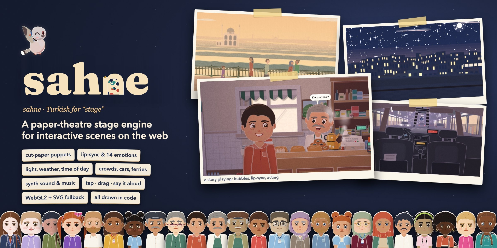
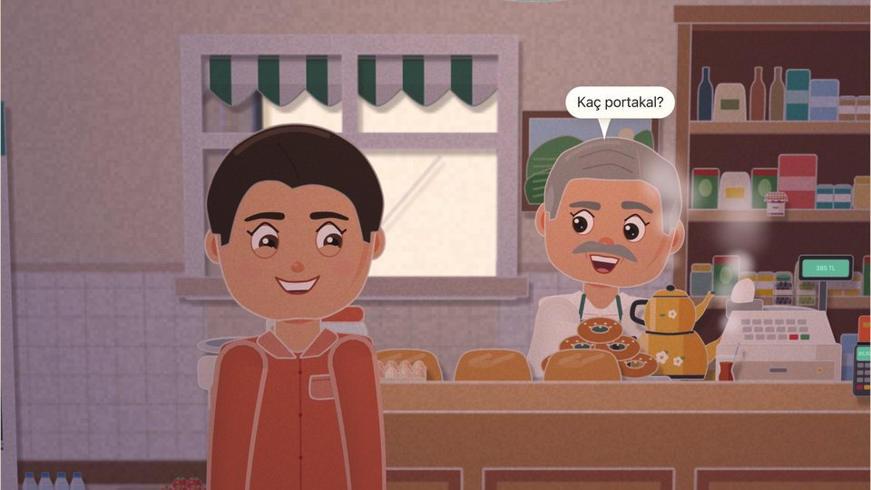
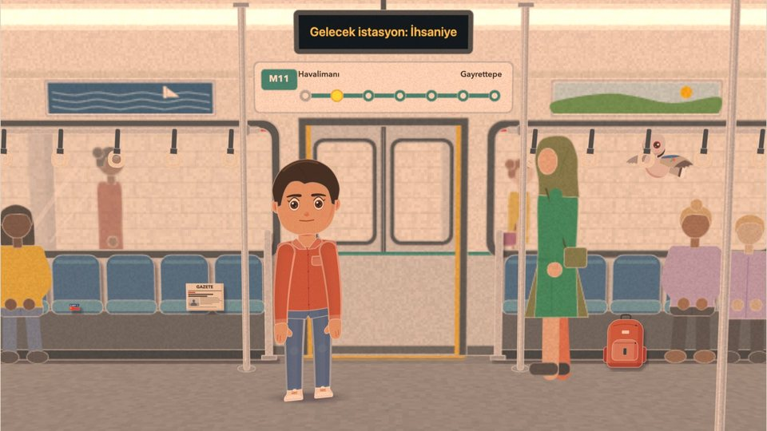
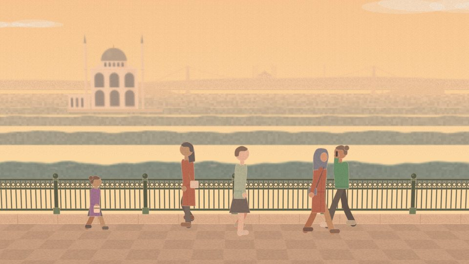
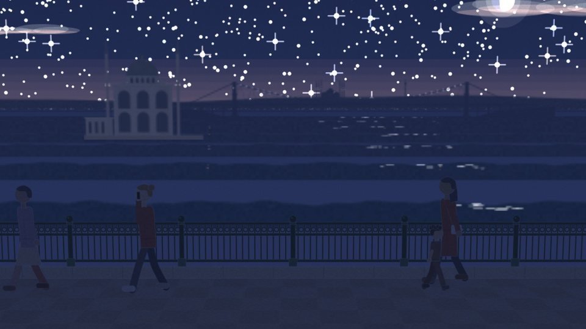
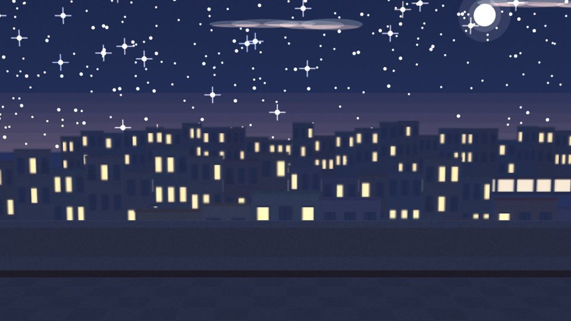
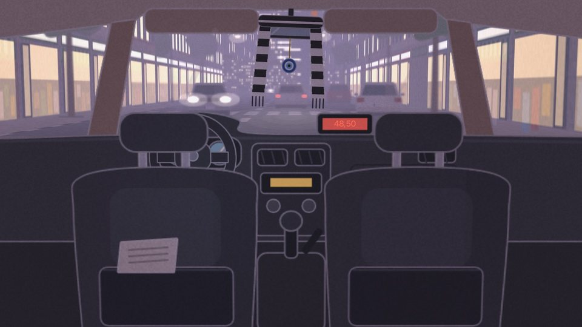
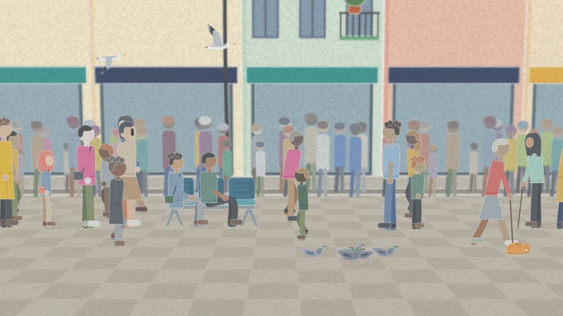
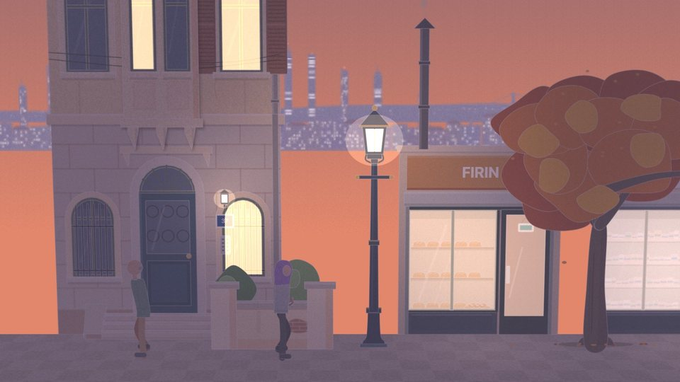

# Sahne

<p align="center"></p>

<p align="center">
  <a href="https://sahne.shab.boo"></a>
  <a href="https://github.com/mehrad77/sahne/actions/workflows/ci.yml"></a>
  <a href="LICENSE"></a>
  <a href="LICENSE-ART"></a>
</p>

*Sahne* is Turkish for "stage". It is a paper-theatre stage engine for illustrated, interactive dialogue scenes on the web. Its characters are made of cut paper. They act in lit places with depth: a camera, the time of day and weather, sound and music, speech bubbles with lip-sync, and things the user can tap, drag or say aloud. Everything is drawn in code, with no image assets, and WebGL2 renders it as paper, with an SVG fallback.

**See it live at [sahne.shab.boo](https://sahne.shab.boo)**: every system with a demo, the kit, the places, a story playing, and these docs.

[Kumru](https://github.com/mehrad77/kumru) is the first app to use it: a Turkish practice app whose stories Kerim, a kumru (collared dove), narrates. Sahne knows no language and no app. The Turkish plugin and the story format are packages of their own.

## Scenes

Every picture here is drawn live by the engine from code and a few hundred bytes of JSON. Each is a frame of the dev gallery: a story playing, or one of the gallery's test places at a time of day.

| | |
|---|---|
|  |  |
| **A story playing.** Bubbles aimed at the mouth, lip-sync from the Turkish spelling, faces and gestures, the camera cutting in. | **On the metro.** The car runs a timetable; the next-station display, the passengers and the view outside all move with it. |
|  |  |
| **The waterfront, golden hour.** Depth bands from the far shore to the railing, a crowd of faceless paper walkers. | **The same place at night.** One place document; the light preset, the sky and the lit windows do the rest. |
|  |  |
| **A roof at night.** The city at three depths, stars, the moon and its glow. | **A taxi ride.** A cabin built in depth; the road and the street scroll past outside. |
|  |  |
| **A crowded street.** Walking lanes, a queue, a group, people on a bench, birds and a cat. | **A neighbourhood street at dusk.** Façades, shopfronts, a lamp post and a tree, all parametric set pieces. |

See every one of them move at [sahne.shab.boo](https://sahne.shab.boo) (or run `pnpm dev`), with the controls for the time of day, the weather and the camera.

## Packages

| Package | What it is |
|---|---|
| [`sahne`](packages/sahne/) | The engine: formats, director, timeline, rig, faces, avatars and the builder, the WebGL2 paper backend and the SVG still backend, audio, interaction. No dependencies. Design: [DESIGN.md](packages/sahne/DESIGN.md) |
| [`sahne-kit`](packages/sahne-kit/) | The first kit: bodies, faces, hair, clothes, set pieces, props, animals, sounds and music, all drawn in code. Style guide: [STYLE.md](packages/sahne-kit/STYLE.md). Every part: [CATALOGUE.md](packages/sahne-kit/CATALOGUE.md), [SET.md](packages/sahne-kit/SET.md) |
| [`sahne-tr`](packages/sahne-tr/) | The Turkish plugin: mouth timing from spelling, word ↔ token matching, say-it-aloud matching, numbers and clock times |
| [`sahne-story`](packages/sahne-story/) | The story format: the adapter (a story document becomes a script), the player, the story check and lints, the schemas, and a sample story |
| [`sahne-gallery`](packages/sahne-gallery/) | The dev gallery: a live demo of every engine system, the whole kit, every place and every story. It also runs the checks (sizes, determinism, golden frames) |

The packages follow the conventions in [packages/README.md](packages/README.md). They ship TypeScript source with erasable syntax only, so Node 24 runs it directly and esbuild bundles it. There is no build step, and nothing is published to npm. An app takes this repo as a git submodule and adds `packages/*` to its pnpm workspace.

## Quick start

You need Node 24 and pnpm 11 (`corepack enable`).

```bash
pnpm install
pnpm --dir packages/sahne-gallery exec playwright install chromium   # once, for the golden frames and screenshots
pnpm dev      # the gallery on http://localhost:5180 (rebuilds on save; reload the page)
pnpm check    # types, sizes, determinism, the story checks, every test, the golden frames
```

`pnpm sahne <script>` runs any script of the gallery (`pnpm sahne golden:update`, `pnpm sahne thumbs`).

**Stories and places come from a content root.** Without configuration, it is `packages/sahne-story/samples/`: one short sample story, three characters with the generated extras, and two places. To play another app's stories in the gallery, point `SAHNE_CONTENT` at its data folder (an absolute path):

```bash
SAHNE_CONTENT=/path/to/kumru/data pnpm dev
```

[packages/sahne-story/README.md](packages/sahne-story/README.md#where-the-data-lives) lists what a content root holds and which checks need what.

## Adding to the kit

Kit art is TypeScript that draws paper shapes. Read [STYLE.md](packages/sahne-kit/STYLE.md) first, then look at a neighbouring part in the gallery (`#/kit/people`, `#/kit/set`).

- **A part for people** (hair, a top, glasses…): draw it in the slot's file in `packages/sahne-kit/src/` (`hair.ts`, `tops.ts`, `eyewear.ts`…), front and back, for every body shape. Add its entry to `src/curation.ts`: `open`, `unlock` or `cast`. If the plan named it, take it out of `catalogue/plan.json`, then run `node packages/sahne-kit/catalogue/build.ts` to regenerate CATALOGUE.md.
- **A set piece or prop:** add it to its family in `packages/sahne-kit/src/set/` with a `meta` (`PieceDef.meta`: what it is, its params, states and variants), then run `node packages/sahne-kit/set/build.ts` to regenerate `families.gen.ts` and SET.md. The gallery's inspector (`#/kit/set/<id>`) gives every param a control.
- **A sound or motif:** `src/sounds.ts` (synth patches) or `src/music.ts`. Recordings must be CC0 and listed in `sounds/SOURCES.md`.

Then run `pnpm check`. The kit's tests hold every part to its slot, its views and its budget. The gallery's coverage test fails while an engine feature has no demo.

## Contributing

Pull requests are welcome. [CONTRIBUTING.md](CONTRIBUTING.md) covers the setup, the checks and what a PR needs, and [AGENTS.md](AGENTS.md) holds the rules every change follows (it is written for coding agents and is just as useful to people). Bugs and kit ideas go in [issues](https://github.com/mehrad77/sahne/issues/new/choose).

## Size budgets

`packages/sahne-gallery/size.mjs` (part of `pnpm check`) bundles and minifies each package on its own, gzips it, and fails when a bundle is over budget ([DESIGN.md](packages/sahne/DESIGN.md) §12):

| Bundle | Budget (gzip) |
|---|---|
| Engine and Turkish plugin | 150 KB |
| Kit code | 150 KB |
| Each set family (`sahne-kit/set`) | 40 KB |
| Kerim's puppet (`sahne-kit/kerim`) | 8 KB |
| The animal puppets (`sahne-kit/puppets`) | 8 KB |
| Portraits (`normalize`, `portrait`, `silhouette`) | 20 KB |
| The builder with its stage | 100 KB |
| All place documents together | 100 KB |
| The whole set, every family together | 250 KB, a warning only (365 KB today) |
| `sahne/listen`, `sahne-story` | measured, no budget |

`determinism.mjs` builds every bundle twice and checks that the two builds are byte-identical, so an app's content-hashed chunks stay stable.

## Licence

- The code is under the [MIT License](LICENSE).
- The kit's art, sounds and music are under [CC BY 4.0](LICENSE-ART).
- Kerim's art and the parts reserved for Kumru's cast are not licensed: all rights are reserved. [LICENSE-ART](LICENSE-ART) names them.
