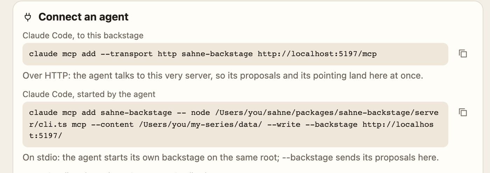
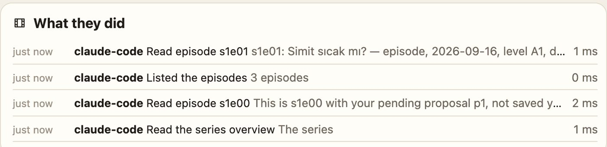
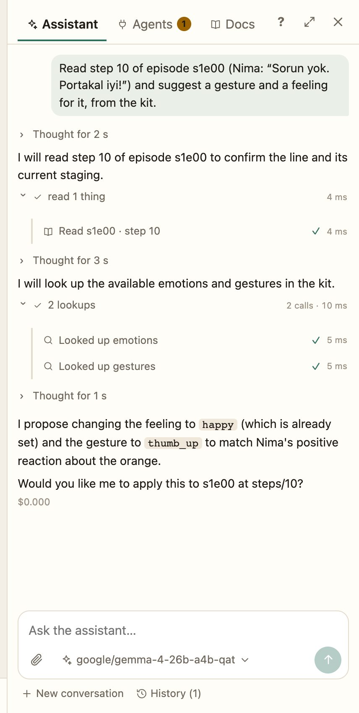
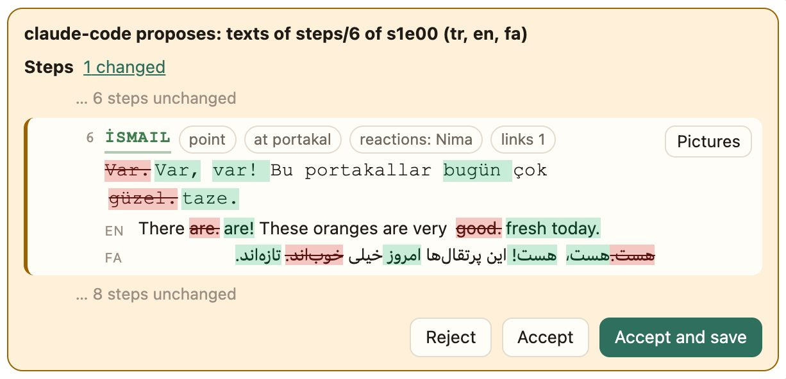

# Agentic story writing

Ask for a week of episodes and watch it happen. A planner reads your series and splits the goal into steps: a new character, the places she needs, five episodes. Each step goes to its own agent. They work side by side, and each one writes a scene, plays it on the stage, looks at the frame, fixes what looks wrong, and hands its work on. You watch them on a page that shows each step working, and when it's done, every line is in your series as plain JSON, ready for you to read through and approve.

This works because in Sahne **a story is data and the stage is code**. An agent doesn't need to paint a picture or cut a video. It writes who says what, to whom, with which gesture, and a whole illustrated, lip-synced, lit scene follows from that. Writing is the one thing language models are best at, and here it is the whole job.

<video controls preload="none" playsinline poster="assets/whats-new/backstage-poster.jpg" style="width:100%;border-radius:12px"><source src="assets/whats-new/backstage.mp4" type="video/mp4"></video>


## Backstage is an MCP server

Every agent works through the same door. [Backstage](../../sahne-backstage/README.md), the studio, is also a [Model Context Protocol](https://modelcontextprotocol.io) server, so any agent that speaks MCP can write your series. That includes Claude Code, Cursor, your own script, and Backstage's own assistant.

```bash
# beside a running backstage: its proposals land in the open editor
claude mcp add --transport http sahne-backstage http://localhost:5181/mcp
```

The tools cover the whole craft, about forty of them.

| The agent can… | With |
|---|---|
| **Read** the series, every episode as a script with paths, a line anywhere, the guides | `series_overview`, `read_episode`, `search_lines`, `read_guide` |
| **Write** lines, translations, staging, whole episodes, seasons, places and characters | `edit_step`, `set_texts`, `set_staging`, `create_episode`, `create_season`, `create_place`, `create_character` |
| **Dress** a character through Sahne's own avatar builder | `read_look`, `set_look` |
| **See** the stage: a scene at any step, mid-gesture, as a picture | `look` |
| **Ask** the director's rules for staging ideas | `suggest_staging` |
| **Draw** new kit items as data, and look at its own drawing | `draft_kit_item`, `kit_render`, `save_kit_item` |
| **Review**: check an episode or a season, comment, approve | `check_episode`, `check_season`, `comment`, `set_review` |
| **Point**: send the open editor to the step it means | `show` |

Every call runs the same story check as a person's save, so an agent finds its own mistakes and fixes them in the next call. That's a big part of why the agents' work comes out right.

The *Agents* page has the command to copy, and a log of every call an agent makes, as it makes it:





## The agent looks at what it made

`look` is the tool that makes this feel like directing. The agent asks for a frame of its scene, say the line at step 12 forty percent of the way through its gesture. The open editor draws that frame on the real stage and sends it back as a picture. The agent sees Nima pointing at the wrong shelf, or a bubble covering a face, and fixes it.

It works for kit items too. An agent drawing a Lisbon tram renders a sheet of it (day and night, every variant, mid-motion), looks at it, and draws again until it's right. The best drawings get [promoted into the kit](../../sahne-kit/DRAWING.md), credited to their author.

## The assistant, beside every page

Press ✦ and the assistant opens beside whatever you're working on. It knows the page, the episode and the line you have selected.

- **It runs on any model.** That can be Claude, or a model on your own machine through LM Studio or Ollama. It's a [LangGraph](https://langchain-ai.github.io/langgraphjs/) agent that reaches Backstage as an MCP client of its own server, so it has exactly the tools above.
- **You see it think.** Its thinking and every tool call stream into the chat as they happen. You can stop it at any moment.
- **It asks with buttons.** When there is a real choice, a card with the options appears in the chat, and one click answers it.
- **It remembers** the lasting decisions of your series ("Nima never says *siz* to his grandfather") in a small notes file that travels with the series in git.
- **It searches the web** when a scene needs a fact, and reads the guides when it needs the format.
- **It takes your pictures**: paste a sketch or a photo of a real bakery into the chat.
- **Quick asks sit where you work**: fill the missing translations, simplify this line, suggest staging, propose choice options, check this scene, draft the episode from its brief, or have a second reader review it with fresh eyes.



## Tasks: a team of agents on one goal

A long ask, like "a week of episodes about the market, with a new stall keeper", becomes a **task**.

1. **A planner** (a strong model) reads the series, the seasons, the cast and the places, and writes a plan. Each step says, in one plain sentence, what it will make.
2. **Each step goes to its own agent**, with a fresh context and its own brief. The steps that can run together do: the stall keeper and the market are made side by side, and the episodes start as soon as both exist. Each step reads the reports of the steps it builds on.
3. **You can steer them mid-flight.** *Tell it something* sends a note to a working step, which reads it before its next thought. *Pause* holds them all, and *Go on* picks up exactly where they were.
4. **It survives anything.** Every step is checkpointed. Close the tab, or restart the machine, and the task goes on from where it was.
5. **It can all be undone.** Every write is journaled. Undo one episode with what was built on it, or press *Back to before this task*. In our own test that left the content folder identical, file by file, to an untouched copy.

There are two ways to run a task. *Check with me* shows you the plan first and asks only about real choices. *Just do it* never stops: each step makes its own choices and says what it chose ("Named her Defne, not Deniz").

The task page is the fun part to watch. Each working step has a live line saying what it's doing right now ("Review s1e03 · Reading s1e03…"), with the time left. Cards appear as people, places and episodes come into being, a soft light sweeps over whatever is being made, and each card says why it was made and what was decided.

## You have the last word, and it's one click

What agents write arrives as a **proposal** on the block it changes. You see the diff word by word, read the way the script reads, with the stage playing it beside you. *Accept and save* takes it in one click. Proposals stack: an agent's next edit builds on its last, and accepting it merges cleanly with whatever you were typing.



Or switch the Agents page to *they write, checked*, and agents write straight into the series while you review afterwards.

## Try it

1. Start Backstage on your series: `node packages/sahne-backstage/server/cli.ts --content <your data> --write`, then open http://localhost:5181. [Get started](get-started.md#write-and-stage-episodes-in-backstage) has the details.
2. Press ✦ and ask: "Draft s1e02 from its brief, then look at each scene and fix the staging."
3. Or connect Claude Code with the command above and say: "Read the series, then write next Monday's episode at the market."
4. Watch the Agents page.

Everything an agent can do, tool by tool: [Backstage's MCP server](../../sahne-backstage/README.md#mcp-server-and-agent-edits-servermcpts-serverproposalsts-servereventsts). How tasks work inside: [Tasks](../../sahne-backstage/README.md#tasks-long-tasks-as-steps-serverruns).
